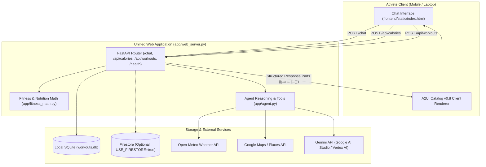

# 🏗️ TriCoach AI — System Architecture

## 1. High-Level Architecture Overview

TriCoach AI uses a modular, decoupled architecture supporting two runtime topologies:



---

## 2. Dual-Mode Deployment Topologies

To optimize for both **zero-cost public web hosting** and **enterprise cloud deployment**, the codebase maintains two runtime paths:

### Mode 1: Unified Standalone Server (`app/web_server.py`)
* **Primary Target**: Render Free Tier, Hugging Face Spaces, Railway, Local Dev.
* **Mechanism**:
  * A single FastAPI process serves both the static UI (`/static`, `/`) and REST endpoints (`/chat`, `/api/calories`, `/api/workouts`).
  * Employs zero-cost local SQLite storage (`workouts.db`) with automatic in-memory testing mode (`:memory:`).
  * Direct request dispatching without external proxy dependencies.
  * Consumes ~110MB RAM, operating well within 512MB free hosting limits.

### Mode 2: Enterprise Agent Engine (`app/agent.py` + `app/fast_api_app.py`)
* **Primary Target**: Google Cloud Vertex AI Reasoning Engines, `agents-cli`.
* **Mechanism**:
  * ADK Agent with `Gemini(model="gemini-flash-latest")`.
  * `a2ui_callback` wrapper parsing output into `<a2a_datapart_json>` format.
  * Cloud Storage bucket (`tricoach-media-...`) upload for generated posters and videos.
  * `VertexAiMemoryBankService` for cross-session durable memory.
  * Code execution in `AgentEngineSandboxCodeExecutor`.

---

## 3. Communication & Data Flow

### The `/chat` Contract
The frontend (`frontend/static/index.html`) communicates with the backend exclusively via `POST /chat`.

**Request**:
```json
{
  "message": "Log 45 min run, 8.5 km, average heart rate 152",
  "user_id": "athlete-01"
}
```

**Response Format**:
The server replies with a list of typed parts. This schema supports plain text, rich declarative UI cards (A2UI), or media links:
```json
{
  "parts": [
    {
      "kind": "text",
      "text": "Great job! Workout logged successfully."
    },
    {
      "kind": "a2ui",
      "data": {
        "surfaceUpdate": {
          "surfaceId": "workout_card",
          "components": [...]
        }
      }
    }
  ]
}
```

---

## 4. Storage Abstraction Layer (`app/db.py`)

The application interacts with data through `WorkoutDatabase`:
1. **SQLite (Default)**:
   * Fast, zero configuration, zero cloud cost.
   * Connection pooling and thread-safe persistent connection for `:memory:` testing.
   * Collision-free ID generation: `workout-{timestamp_ms}-{uuid_hex}`.
2. **Google Cloud Firestore (Opt-in)**:
   * Activated only when `USE_FIRESTORE=true` and valid GCP project credentials exist.
   * Mirrors the SQLite schema for seamless portability.
